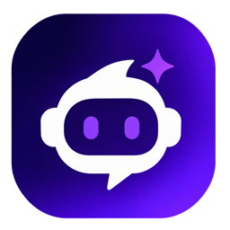

<p align="center">
  
</p>

<h1 align="center">Zenoxi</h1>

<p align="center">
  An AI chat assistant with live web search, document Q&amp;A and a resume ATS tool,<br>
  where one conversation continues across the website, Instagram and WhatsApp.
</p>

<p align="center">
  <a href="https://zenoxi.vercel.app">Live app</a> ·
  <a href="docs/USER_GUIDE.md">User guide</a> ·
  <a href="docs/API.md">API</a> ·
  <a href="docs/DEPLOYMENT.md">Deployment</a> ·
  <a href="docs/README.md">All docs</a>
</p>

---

## Features

| | Feature | What it does |
|---|---|---|
| 💬 | **AI chat** | Streaming answers from free OpenRouter models, with chat history and Markdown/code rendering. |
| 🔎 | **Live web search** | Optional per message: searches the web (Tavily, with a free keyless fallback) and answers with numbered, clickable sources. |
| 📄 | **Documents** | Attach PDF, Word, text, CSV, JSON or code files; Zenoxi reads them and answers questions about them. |
| 💼 | **Resume ATS Match** | Scores a resume against a job description, lists missing keywords and formatting issues, and generates a tailored one-page resume (PDF/DOCX) without inventing experience. |
| 🤖 | **Website Agents** | Businesses build their own AI assistant by chatting with Zenoxi, then add a floating chat widget to their website that answers from their information and collects inquiries. Owners get a leads dashboard with Excel export, email alerts and confirmations (with brochures), reports, analytics, avatars and a Hindi/Telugu/Tamil widget. |
| 🔁 | **One chat everywhere** | Continue the same conversation on the website, Instagram DMs and WhatsApp, with link codes and live sync. |
| 🛡️ | **Admin dashboard** | For the platform owner at `/admin`: users (block, delete), agents, email log, system health and 14-day activity. |
| 🔐 | **Accounts** | "Continue with Google" or passwordless sign-in with a 6-digit email code. Every user only sees their own chats. |
| 🎨 | **Animated UI** | React + Framer Motion interface with light/dark themes, a mobile layout and an animated orb assistant. |

## Tech stack

| Layer | Technology |
|---|---|
| Frontend | React 18, Vite 6, Framer Motion, Tailwind CSS (base), react-markdown |
| Backend | Python 3.12, FastAPI, Uvicorn, Pydantic Settings |
| Database | MongoDB Atlas (PyMongo async client) |
| AI | OpenRouter (`openrouter/free` model router) |
| Search | Tavily API, fallback to `ddgs` (Bing, DuckDuckGo, Brave and others) |
| Documents | pypdf, python-docx, reportlab (PDF output) |
| Auth | Google Identity Services + `google-auth`, email codes via Brevo or SMTP |
| Messaging | WhatsApp Cloud API, Instagram API (Unified login) |
| Hosting | Vercel (frontend), Render (backend), MongoDB Atlas |

## Quick start (local)

**Requirements:** Python 3.11+, Node.js 20+, a MongoDB connection string, and an OpenRouter API key.

```bash
git clone https://github.com/anilchary225/chat-bot-ai.git
cd chat-bot-ai
```

**Backend:**

```bash
cd backend
python3 -m venv .venv
source .venv/bin/activate
pip install -r requirements.txt
cp .env.example .env            # then fill in MONGODB_URI, OPENROUTER_API_KEY, AUTH_SECRET
uvicorn app.main:app --reload --host 127.0.0.1 --port 8000
```

**Frontend** (in a second terminal):

```bash
cd frontend
npm install
cp .env.example .env            # VITE_API_URL=http://127.0.0.1:8000
npm run dev
```

Open http://localhost:5173. With no email service configured, sign-in codes are printed in the backend terminal.

API docs (Swagger UI) are served at http://127.0.0.1:8000/docs.

## Documentation

| Document | For |
|---|---|
| [User guide](docs/USER_GUIDE.md) | People using Zenoxi: chat, search, files, resume tool, Instagram/WhatsApp |
| [Architecture](docs/ARCHITECTURE.md) | How the system fits together, data model, request flows |
| [API reference](docs/API.md) | Every HTTP endpoint, with request/response examples |
| [Configuration](docs/CONFIGURATION.md) | Every environment variable, backend and frontend |
| [Deployment](docs/DEPLOYMENT.md) | Render, Vercel, MongoDB Atlas, Google, email, go-live checklist |
| [Messaging setup](docs/MESSAGING_SETUP.md) | Connecting WhatsApp and Instagram through Meta |
| [Development](docs/DEVELOPMENT.md) | Project structure, local workflow, conventions |
| [Troubleshooting](docs/TROUBLESHOOTING.md) | Known problems and fixes |
| [Security](SECURITY.md) | Security model and how to report vulnerabilities |
| [Contributing](CONTRIBUTING.md) | How to propose changes |
| [Changelog](CHANGELOG.md) | Release history |

## Project status

Zenoxi is in active development (version 0.5.0). The website is live for everyone. Instagram works for accounts added as
testers, and WhatsApp needs Meta business verification before real messages are delivered
(see [Messaging setup](docs/MESSAGING_SETUP.md#going-live-for-everyone)).

Saving AI tokens is built in (instant FAQ answers, an answer cache, trimmed context). To run several API copies
behind nginx on your own server, see [deploy/nginx](deploy/nginx/README.md).

Sign-in and agent emails go through Brevo. For best delivery, turn off Brevo's IP blocking and send from your own
authenticated domain (see [Deployment](docs/DEPLOYMENT.md#5-email-for-sign-in-codes)).

Free-tier limits apply: OpenRouter's free models allow about 50 requests a day, and Render's free plan sleeps after
about 15 minutes idle (the first request then takes up to a minute).

## Legal

- [Privacy Policy](https://zenoxi.vercel.app/privacy) · [Terms of Service](https://zenoxi.vercel.app/terms) ·
  [Data deletion](https://zenoxi.vercel.app/data-deletion)
- No open-source license has been chosen yet, so all rights are reserved by the author.
